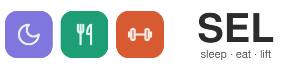

<p align="center">
  <picture>
    <source media="(prefers-color-scheme: dark)" srcset="docs/logo/sel-logo-dark.svg">
    
  </picture>
</p>

# SEL — sleep · eat · lift

**SEL** (sleep · eat · lift) — приложение для Mac и Windows: питание и вес из **FatSecret**, сон, восстановление, тренировки и шаги из **Whoop** —
на нескольких страницах с графиками, календарями и целями.
Интерфейс и документация — на русском.

Всё личное (CSV с историей, фото, ключи доступа) хранится **вне проекта** — в папке данных, которую приложение
спрашивает при первом запуске (по умолчанию `~/Documents/SEL/data`). В проекте — только программа и документы.

## Из чего состоит

| Папка | Что внутри |
|---|---|
| `desktop/` | Приложение на Electron: окно, протокол `app://h/`, загрузка FatSecret и Whoop, запись CSV, сборка и выпуск |
| `portal/` | Страницы приложения (HTML + JS без сборщика): сводка, питание, тренировки, восстановление, фото, настройки |
| `portal/vendor/` | Библиотеки страницы «Фото» (MediaPipe, libheif, exifr) — фиксированные версии, ставит `scripts/vendor_fetch.js` |
| `scripts/` | Служебное на Node: запись данных из командной строки, проверка перед публикацией, загрузка библиотек «Фото» |
| `docs/` | Формат данных, съёмка фото формы, политика конфиденциальности, дизайн приложения — см. ниже |

Как это работает: приложение загружает данные сервисов в CSV папки данных → собирает из них `data.js` (сырые
таблицы) → страница подключает `data.js`, `portal/dataset.js` считает показатели, `portal/common.js` рисует графики.

## Как запустить у себя

Ключей FatSecret и Whoop в репозитории нет — нужны свои (бесплатные ключи разработчика).

1. **FatSecret** — зарегистрировать приложение на [platform.fatsecret.com](https://platform.fatsecret.com)
   (OAuth 1.0, нужен доступ к дневнику и весу пользователя). Адрес возврата — `https://health.local/fatsecret`
   (если сервис его не примет, вход идёт через код подтверждения).
2. **Whoop** — приложение на [developer.whoop.com](https://developer.whoop.com), адрес возврата
   `https://health.local/whoop`, права: `offline read:recovery read:cycles read:workout read:sleep read:profile read:body_measurement`.
3. Запустить приложение (см. «Разработка»), выбрать папку данных, создать в ней `secrets/` и положить туда:
   - `fatsecret_app.json` — `{"consumer_key": "…", "consumer_secret": "…"}`
   - `whoop_app.json` — `{"client_id": "…", "client_secret": "…", "redirect_uri": "https://health.local/whoop"}`
4. «Настройки» → «Подключить» FatSecret и Whoop. Данные загрузятся за год.

Сборка (`npm run app:mac`, `npm run dist:win`) встраивает эти ключи приложения внутрь приложения: собранное приложение можно давать знакомым,
но не выкладывать публично — ключ из него можно достать.

## Разработка

Нужен Node.js (с npm); для отрисовки страниц в тестах — Google Chrome.

```bash
cd desktop && npm install
```

```bash
cd desktop && npm start
```

Тесты — после любой правки (приложение, расчёты и вёрстка страниц, формат данных):

```bash
cd desktop && npm test
```

С отрисовкой страниц в Chrome:

```bash
cd desktop && RENDER=1 npm test
```

Проверка окна без клика (страница, меню, статус — в консоль):

```bash
cd desktop && HEALTH_DOCUMENTS=/tmp/health-docs HEALTH_SMOKE=1 HEALTH_PAGE=training.html npx electron .
```

Сборка и установка в `/Applications` (ключи приложений FatSecret и Whoop берутся из `<папка данных>/secrets`,
после сборки автоматически проверяется, что внутри нет личного и токенов):

```bash
cd desktop && npm run app:mac
```

Версия для Windows собирается на том же Mac — один файл `dist/<версия>/SEL-<версия>-win-x64.exe`, работает без установки
(без подписи: при первом запуске «Подробнее» → «Выполнить в любом случае»):

```bash
cd desktop && npm run dist:win
```

Выпуск версии: пункты копятся в разделе «Не выпущено» файла `desktop/CHANGELOG.md`, затем
`cd desktop && npm run release X.Y.Z`, `npm run app:mac` и `npm run dist:win`. У каждой версии — папка `dist/<версия>/`:
заметки `release-notes.md` и сборки для Mac и Windows; сборка до выпуска (есть «Не выпущено») — в `dist/dev/`.
Правила версий — в `CLAUDE.md`.

## Безопасность и приватность

- **Данные не уходят из компьютера**: приложение обращается только к API FatSecret и Whoop. Страницы не могут
  ничего загрузить или отправить наружу — это запрещает политика содержимого (CSP) протокола `app://h/`.
- **Протокол `app://h/` отдаёт только разрешённое**: страницы приложения, `data.js` и фото. CSV, `meta.json`,
  ключи и выход за папки (`..`, символические ссылки) — 404 (`desktop/protocol.js`, тесты).
- **Окно изолировано**: `contextIsolation`, `sandbox`, без Node на страницах; переходы — только внутри `app://h/`;
  внешние ссылки — только на белый список сайтов FatSecret и Whoop; IPC принимает вызовы только со своих страниц.
- **Текст из данных выводится как текст**: заметки, названия видов спорта и т. п. на страницах — только через `esc()`.
- **Ключи доступа** — в `<папка данных>/secrets/*.json` с правами 600; в git их нет и не было (проверено по всей
  истории). Собранное приложение содержит только ключи *приложений* FatSecret и Whoop — так устроен OAuth у
  настольных программ; токены пользователя проверка сборки внутрь не пускает.
- **В репозитории нет личного**: `node scripts/public_check.js` сверяет каждый файл со строками CSV и значениями
  ключей из папки данных (то же делает тест, если папка данных есть на этом компьютере). Личные заметки для Claude —
  в `CLAUDE.local.md` (не в git).

## Документация

| Документ | О чём |
|---|---|
| [CLAUDE.md](CLAUDE.md) | Правила проекта для Claude Code: структура, приложение, тесты, данные |
| [docs/06 — фото](docs/06_фото_инструкция.md) | Как снимать и разбирать фото формы |
| [docs/07 — формат данных](docs/07_формат_данных.md) | Папка данных, все CSV и их колонки |
| [docs/privacy-policy.html](docs/privacy-policy.html) | Политика конфиденциальности (для экрана входа Whoop) |
| [docs/superpowers/](docs/superpowers/) | Дизайн и планы: приложение на Electron, «Что нового» |
| [desktop/CHANGELOG.md](desktop/CHANGELOG.md) | История версий приложения |
| [SECURITY.md](SECURITY.md) | Как сообщить об уязвимости |
| [docs/logo/](docs/logo/) | Логотип SEL: знак из трёх плиток (сон, еда, железо), светлая и тёмная версии |

## Лицензия

[MIT](LICENSE). Библиотеки в `portal/vendor/` — под своими лицензиями ([portal/vendor/LICENSES](portal/vendor/LICENSES)).
